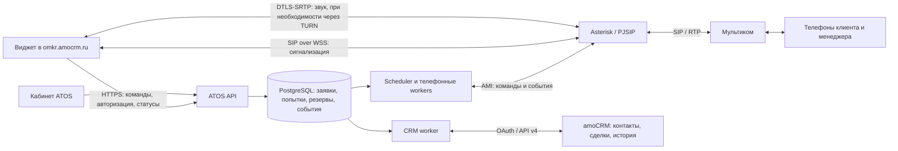

# Рабочая архитектура ATOS, Мультикома и виджета amoCRM

Дата: **22.11.2026, Москва**. Исходная версия: `b07a0b0`, Alembic `0012`. Поставка виджета **5.2.0** использует схему **0013**.

Документ описывает архитектуру и дальнейший план. В поставке 5.2.0 реализованы подписанный API виджета, два способа разговора, готовность мобильного плеча без клавиши 1 и установщики WebRTC/TURN. Применение: [AMO_WIDGET_SETUP_RU.md](AMO_WIDGET_SETUP_RU.md). Дальнейшие OAuth/reconciliation/входящие/расширенная телефония остаются планом, если отдельно не указана приёмка.

Основание: ТЗ `ATOS_TZ_1.0_2026-11-21.md`, текущий код и подтверждённые владельцем серверные проверки. Более поздние решения владельца уточняют ТЗ: работа сосредоточена на Мультикоме; нужны оба способа разговора; WebRTC входит в обязательный результат; проверенные изменения публикуются небольшими коммитами прямо в `main`.

## 1. Конкретный результат и границы

Аккаунт CRM: **`https://omkr.amocrm.ru`**. Ожидаются **4–7 одновременно разговаривающих менеджеров**, целевой первый запуск — 7.

Менеджер открывает контакт или сделку, выбирает телефон клиента и способ разговора, нажимает «Позвонить через ATOS». Доступны:

- **В браузере amoCRM**: микрофон/гарнитура компьютера, WebRTC, один внешний канал Мультикома.
- **На личном телефоне**: ATOS сначала вызывает телефон менеджера, затем клиента, два внешних канала Мультикома. После ответа менеджера клиент набирается автоматически. Клавиша 1 удалена по решению владельца.

Оба режима используют общий backend: личность оператора, права, резервирование, пул А-номеров, состояния, журнал, записи, CRM-доставку и аналитику. Одиночный вызов и массовая кампания отличаются источником заявки и правилами очереди, а не отдельными механизмами дозвона.

Существующие контакты, история, номера, интерфейс ATOS и рабочая мобильная связь сохраняются. Публичный SaaS с биллингом, голосовой ИИ и внешние CRM не нужны для приёмки этих двух способов разговора. Входящие, очередь, hold/transfer и отчётность развиваются на том же ядре по очереди реализации ниже.

## 2. Исходный аудит до поставки 5.2.0

| Блок | Фактическое состояние на исходной версии | Следующее изменение |
|---|---|---|
| Мультиком SIP/PJSIP | Echo подтверждён владельцем для двух DID | Проверка остальных разрешённых DID и общей ёмкости |
| Мобильный operator-first | Звонок `c3ccc809-a559-4a86-b368-550c172c247c`: 115 с, двусторонняя речь, Alim автоматически свободен | Сохранить рабочий путь; добавить явную политику подтверждения |
| Плечи и завершение | Два `call_legs`, подтверждение моста, защита от раннего Hangup, unknown | Общий контроллер обоих режимов и автоматическая сверка AMI/CEL/CDR |
| Ротация | Weighted-least-used, cooldown, дневной бюджет, права оператора | Транковый ledger, темп набора, часовые лимиты, ожидание пула в live UAT |
| Идентификация в виджете | Origin и чтение `/users/{id}`; ID приходит из браузера | Подтверждённая операторская сессия и точная привязка аккаунта |
| Контакты CRM | Импорт и связи существуют; есть пути с автоматическим `consent=True` | Независимый учёт основания звонка; импорт не выдаёт согласие |
| Контекст сделки | Внешний ID контакта и общий `crm_context` | Явные account/lead/contact/phone snapshots у заявки и попытки |
| amoCRM API | Чтение, calls/notes/tasks, очереди и unknown при неопределённой записи | Полный OAuth lifecycle и отдельные идемпотентные стадии доставки |
| Виджет | Click-to-call; при отсутствии текущего пользователя возможен fallback на ответственного сделки | Только подтверждённый пользователь; полноценный телефон и живой статус |
| WebRTC | Нет браузерного SIP-клиента и готовых WSS/TURN конфигураций | Реализовать и принять весь браузерный тракт |
| Записи | MixMonitor и подбор файлов; текущий импорт ограничен 10 MiB | Завершение файла, потоковая доставка, срок хранения, CRM-ссылка |
| Интерфейс | SSE/NOTIFY и резервный polling | Общие snapshot/version и состояние соединения виджета |

Последние зафиксированные проверки: 187 backend-тестов на Python 3.12 и 3.13, 31 frontend-тест, 7 native Asterisk-сценариев. Это результаты предыдущей реализации, не новый тест всей целевой архитектуры.

Критический вывод аудита: существование `amo_user_id` в справочнике не доказывает, кто отправил запрос. Подтверждение OAuth-аккаунта также само по себе не аутентифицирует каждого менеджера. Эти проверки разводятся до подключения нового виджета.

## 3. Компоненты и ответственность

Сохраняется **модульный монолит**: FastAPI, PostgreSQL 17, SQLAlchemy/Alembic, React и отдельные worker-процессы. Для текущего масштаба PostgreSQL outbox/inbox достаточен; Redis/Celery не вводятся без измеренной необходимости. Аудио обслуживает Asterisk.

| Компонент | Владеет | Необходимая логика |
|---|---|---|
| Кабинет ATOS | Административные действия | Настройки, mappings, кампании, диагностика, журнал, записи |
| Виджет amoCRM | Действия вошедшего менеджера и браузерное устройство | Выбор телефона/режима, звонок, mute/DTMF/hangup, живое состояние |
| Call API | Приём и проверка команд | Авторизация, контекст CRM, request ID, доступ к вызову |
| Allocator | Ресурсы новых попыток | Оператор, DID, общий транк, лимиты и расписание в одной транзакции |
| Telephony controller | Отправка телефонных команд | Единственный путь Originate/Hangup/разрешения второго плеча |
| Event processor | Бизнес-состояние звонка | Correlation, события плеч и моста, монотонные переходы |
| Reconciler | Восстановление состояния | Живые каналы, CEL/CDR, результат неопределённых команд |
| Recording worker | Готовность и хранение записи | Закрытие файла, метаданные, защищённая выдача |
| CRM worker | Доставка в amoCRM | OAuth, синхронизация сущностей, calls/notes/tasks/recordings |
| Asterisk | SIP-сигнализация и реальное медиа | WebRTC/SIP, Dial/bridge, размыкание, MixMonitor, CEL/CDR |
| Мультиком | Внешняя телефонная сеть | Регистрация, разрешённый CLI, операторская ёмкость и внешние CDR |

API не делает синхронный платный звонок внутри HTTP-запроса. Сеть не удерживает длительную блокировку PostgreSQL. CRM не управляет освобождением телефонного канала.

## 4. Подтверждённая личность менеджера

Постоянная связь:

`tenant ATOS ↔ amoCRM account ID ↔ amoCRM user ID ↔ ATOS user/operator ↔ устройства ↔ разрешённый пул DID`.

Аккаунт проверяется по ID и разрешённому origin `https://omkr.amocrm.ru`. Оператор определяется сервером из подтверждённой сессии. Ответственный сделки — отдельное бизнес-поле; он может отличаться от инициатора звонка и не заменяет его при отсутствии авторизации.

В поставке 5.2.0 проверен официальный контракт `$authorizedAjax`: amoCRM добавляет `X-Auth-Token`, JWT HS256 со сроком до 30 минут. Источник: `amocrm/amocrm-api-php`, commit `a0072fec651b84500c6767f98bbab6d1c8df9ce4`, `AmoCRMOAuth::parseDisposableToken`, `DisposableTokenModel`, `examples/parse_disposable_token.php`.

Администратор сохраняет зашифрованный секрет этой приватной интеграции, её UUID, account ID, access token и mapping `extension → amo user ID`. Backend проверяет подпись, audience, account ID, client UUID, subdomain, срок, точный Origin и активного оператора ATOS. Audience совпадает с origin redirect URI интеграции и `ATS_PUBLIC_ORIGIN`. Отдельный popup и пароль ATOS менеджеру не нужны. Переданный браузером user ID не считается удостоверением.

Клиент получает только своё ограниченное SIP-устройство, WSS и временные TURN credentials. AMI/SIP-пароль транка, секрет интеграции и refresh token не передаются. Status/start/ready/hangup доступны владельцу заявки. Работа не зависит от сторонних cookies, токены не помещаются в URL. В этой поставке виджет использует polling; SSE и полный OAuth lifecycle остаются дальнейшими задачами. Для API CRM используется сохранённый действующий access token.

## 5. Единый запрос вызова и данные CRM

Запрос содержит `request_id`, ссылку на открытую сущность, выбранный контакт/номер, способ разговора и версию настроек устройства. Сервер получает operator/tenant/account и разрешённый DID самостоятельно.

В сделке с несколькими контактами или телефонами виджет показывает выбор. Backend проверяет, что выбранный контакт действительно связан с открытой сделкой и доступен менеджеру. Произвольный номер из DOM не становится авторитетным источником. Передаются и сохраняются отдельно:

- account ID, entity type/ID, lead ID, contact ID и выбранная телефонная запись;
- инициатор вызова и ответственный сделки;
- телефон, имя и настройки на момент попытки;
- источник `amo_widget`, `atos_manual`, `campaign` или `inbound`.

Существующий unique phone у `contacts` не используется как доказательство тождества людей. Для нескольких CRM-контактов с одним телефоном нужны явные CRM bindings/контактные методы и выбор сущности; автоматического слияния разных клиентов нет. Техническая нормализация номера, личность контакта и основание звонка остаются разными данными.

Заявка в очереди получает собственный durable ID. После выделения ресурсов появляется `attempt_id`, который используется для Asterisk/событий/истории. Ответ `202` означает «заявка принята», не «клиент уже набран». Виджет отслеживает обе стадии. Повтор того же request ID возвращает ту же заявку; изменение содержимого с тем же ID — конфликт. Проверка дублей сохраняется при повторе HTTP и восстановлении виджета.

Текущий код представляет единичный звонок одиночной кампанией. На переходном этапе это сохраняется как совместимый внутренний механизм; новый интерфейс показывает единичный звонок и источник, не засоряет список массовых кампаний.

Импорт контакта не устанавливает согласие на звонки автоматически. Согласие, отказ и источник разрешения ведутся независимо от справочника CRM и проверяются перед фактическим набором.

## 6. Сценарий «В браузере amoCRM»

1. Менеджер авторизован, включил режим «В браузере», выбрал микрофон/вывод звука и нажал «Позвонить».
2. Виджет проверяет микрофон, браузерный SIP-клиент, выбранное активное устройство и создаёт одну заявку.
3. ATOS проверяет mapping, контакт, расписание и лимиты, резервирует менеджера, DID и один внешний слот.
4. Asterisk устанавливает операторское соединение с зарегистрированным WebRTC endpoint. Виджет принимает только соединение, соответствующее инициированной им заявке; посторонний INVITE автоматически не принимается.
5. Готовность подтверждают и Asterisk, и виджет: правильное плечо, установленная ICE/DTLS-связь, доступный локальный аудиотрек. Наличие регистрации или SIP `200 OK` без готового медиа недостаточно.
6. Сервер повторно проверяет допуск и разрешает набор клиента через выбранный alias Мультикома. Менеджер слышит ход вызова.
7. После ответа клиентского плеча и появления моста начинается учёт разговорного времени; при включённой записи запускается её рабочая стадия.
8. Любой участник завершает разговор — Asterisk закрывает плечи, ATOS подтверждает итог, освобождает ресурсы и ставит CRM-задачи.

Клавиша 1 не требуется. Готовность браузера — отдельное подтверждённое событие, а не автоматическое доверие ответу сети.

Медиа: browser ↔ Asterisk по DTLS-SRTP; Asterisk ↔ Мультиком по согласованному SIP/RTP. Начальная кодековая база — G.711 PCMA/PCMU, совместимая с обоими сторонами. Opus добавляется после проверки модуля транскодирования и CPU; G.729 не является обязательным условием браузерного режима.

## 7. Сценарий «Личный телефон» и отказ от клавиши 1

1. Менеджер выбирает «Личный телефон», сохранённый номер и нажимает «Позвонить».
2. ATOS резервирует менеджера, выбранный DID и **два внешних слота**, затем набирает менеджера через Мультиком.
3. После ответа сети Asterisk автоматически сообщает `ready_source=network_answer`. Запрос клавиши 1 и зависимость от звукового файла удалены.
4. Сохраняется backend gate: занятость/личность менеджера, номер клиента, согласие/запрет, расписание, кампания, DID и лимиты повторно проверяются перед вторым внешним набором.
5. Менеджер остаётся на линии, слышит вызов клиента; после ответа клиентского плеча соединение учитывается как один разговор.
6. Завершение одного участника вызывает закрытие второго плеча; успешный итог и освобождение менеджера подтверждаются по фактическим событиям.

Новые звонки работают без DTMF-подтверждения. Обработчик понимает старое событие `confirmed` только для совместимости с ещё не обновлённым диалпланом. Установщик обновляет точные опубликованные V1/V2 до V3 и сохраняет приватный backup.

Автоответчик, ассистент и ранний ответ сети могут разрешить набор клиента в `auto` до готовности менеджера. Задержка в несколько секунд и факт наличия RTP не доказывают ответ человека. Система сохраняет `ready_source=network_answer/browser/dtmf` и не объявляет автоматическое распознавание человека реализованным. Переключение на другой способ разговора во время живого вызова — отдельный transfer, не новый параллельный originate.

Это мост двух вызовов на Asterisk. Переадресация у оператора связи не требуется. Клиент видит DID Мультикома; личный номер менеджера не используется как исходящий CLI клиента.

## 8. Каналы, ротация и семь менеджеров

| Одновременно разговаривают | Через браузер | Через личные телефоны |
|---|---:|---:|
| 4 менеджера | 4 внешних канала | 8 внешних каналов |
| 7 менеджеров | 7 внешних каналов | 14 внешних каналов |

Для смешанного состава: `external_slots = browser_calls + 2 × mobile_calls + прочие занятые внешние плечи`. Входящие и вызовы legacy ATS учитываются, если расходуют тот же договорный транк.

**15 DID не означают 15 каналов.** Все aliases используют одну SIP-учётную запись. Реальные concurrency/CPS и правила входящих подтверждаются отдельно. При подтверждённых 15 общих каналах семь мобильных разговоров займут 14 и оставят один; эта арифметика не является доказательством договорной ёмкости или достаточности входящего резерва.

Allocator резервирует в одной транзакции operator + DID + trunk slots + attempt + outbox. DB-ограничения предотвращают два активных разговора одного менеджера и превышение бюджета при одновременных запросах. Внешние не принадлежащие ATOS каналы учитываются как отдельная занятость, чтобы не прибавлять одни физические плечи к их собственным резервам дважды.

Ротация сначала исключает недопустимые номера, затем выбирает по weighted-least-used с предсказуемым tie-breaker. Проверяются активность, подтверждение, alias, права оператора/команды, дневная и часовая квоты, cooldown, занятость DID и здоровье транка. Жёсткая привязка применяется до общего пула.

Конкуренция разговоров DID и число внешних плеч — разные метрики: одна мобильная сессия использует один выбранный DID и два внешних набора. Текущая консервативная квота резервирует 1 единицу для браузерного и 2 для мобильного вызова; фактические отправки и провайдерская тарификация хранятся отдельно.

Темп набора учитывает **каждый** внешний набор, включая второе мобильное плечо. Одно резервирование двух слотов не даёт права обойти CPS при наборе клиента. Охлаждение между началами попыток сохраняется; дополнительная пауза после разговора вводится отдельной политикой. Ограничение повторов Б-номеру действует через весь пул, а не сбрасывается при смене DID.

У массовой кампании очередь ждёт освобождения допустимого номера. У ручного клика есть короткий конфигурируемый срок ожидания и видимая причина; заявка не должна внезапно позвонить через несколько часов или на следующий день. Если менеджер уже занят, новый ручной клик получает понятный отказ. Автоматический fallback с браузера на мобильный без выбора пользователя не запускается.

## 9. Общая машина состояний и завершение

Техническая последовательность:

`queued → reserved → operator_dialing → operator_answered → operator_ready → customer_dialing → customer_answered → bridged → ending → completed`.

Альтернативные исходы: `blocked`, `failed`, `busy`, `no_answer`, `cancelled`, `unknown/reconciliation_required`. Это целевая фазовая модель. Существующие `Attempt.status` сохраняются через совместимую проекцию и не получают новые значения без миграции.

У попытки различаются: ответ менеджерского направления, готовность менеджера, ответ клиента, наличие моста, закрытие физических плеч, бизнес-результат и состояние CRM-доставки. `Originate accepted`, Hangup cause 16 и HTTP 200 не означают успешный разговор сами по себе.

`talk_duration = bridge_end - bridge_start`. Время очереди, дозвона, ответа менеджера и CRM-задержки считаются отдельно. Статистика содержит один бизнес-звонок независимо от количества Local/PJSIP channels и повторов событий. Ответ клиентского плеча не доказывает человека на стороне клиента.

Живые события AMI сохраняются в durable inbox/журнал с source, uniqueid, linkedid, bridge, event time/received time, dedupe key и версией проекции. Native AMI и custom UserEvent проходят одну редукцию, а не две независимые машины состояний.

Reconciler работает после AMI reconnect и периодически. Он сопоставляет живые каналы, CEL/CDR и snapshot попытки. Пока реальное состояние не установлено, слот остаётся uncertain, новый звонок не создаётся. Подтверждённое отсутствие активных плеч позволяет освободить физические ресурсы; если бизнес-результат всё ещё недоказуем, он остаётся unknown без автоматического повторного набора. Ресурсное состояние и результат вызова не подменяют друг друга. Ручное решение требует аудита и evidence.

Команды cancel/hangup асинхронны: принятие команды отображается как «Завершаем», закрытие — после событий. Pause/stop новых наборов не обрывает идущие разговоры. При гонке cancel с уже отправленной командой сохраняется фактический исход; UI не обещает, что уже отправленный INVITE можно отменить задним числом.

## 10. Операторы и устройства

Вместо одного ручного поля учитываются независимые признаки: авторизация пользователя, выбор режима, heartbeat браузера, SIP contact, ручной перерыв, резерв, живой мост и wrap-up.

Эффективные статусы: `offline`, `unavailable`, `available`, `reserved`, `ringing`, `talking`, `wrap_up`, `unknown`. Ручное «Свободен» не снимает действующий резерв. Освобождение после доказанного завершения не зависит от доступности amoCRM.

У менеджера могут быть WebRTC endpoint и личный телефон; один выбирается для конкретной попытки. Несколько вкладок amoCRM не создают несколько разговоров: активное голосовое устройство и резерв закрепляются сервером. Межвкладочный канал браузера лишь улучшает UX и не заменяет DB-lock/lease.

Переход между карточками amoCRM сохраняет телефонный клиент и текущую сессию. Перезагрузка страницы не может восстановить уже уничтоженный браузерный PeerConnection одним восстановлением HTTP-сессии: UI восстанавливает сведения, а Asterisk проверяет и завершает потерянное медиа. При разрыве только WSS существующий RTP может продолжаться; решение принимается по каналу/медиа и grace policy. Мобильный разговор после закрытия карточки продолжает обслуживать Asterisk.

## 11. WebRTC, размещение и сеть

Основной HTTPS origin ATOS — используемый `axiomats.ru`, после проверки фактического proxy/TLS. Выделенный `rtc.axiomats.ru` — планируемый адрес, а не уже настроенный DNS. Телефонные конфигурации шаблонизируются и устанавливаются идемпотентным скриптом.

| Назначение | Размещение / доступ |
|---|---|
| HTTPS ATOS, команды и события | Публичный 443 через reverse proxy; API остаётся на loopback |
| SIP over WSS | Выделенный TLS route/host, proxy только к Asterisk websocket path |
| AMI | Loopback `127.0.0.1:5038`, отдельные права; без доступа из виджета |
| PostgreSQL и PJSIP provisioning | Закрытый доступ служб, отдельные роли |
| Мультиком SIP/RTP | Существующий провайдерский маршрут; ACL по подтверждённым диапазонам |
| WebRTC RTP/ICE | Отдельно проверенные NAT/public address и media range |
| TURN | coturn с временной авторизацией, UDP/TCP 3478 и TLS 5349; 443/TCP требует отдельного IP или проверенной схемы разделения с HTTPS |

WSS передаёт SIP-сигнализацию; голос не идёт через FastAPI или SSE. DTLS-SRTP защищает браузерное плечо; это не заявление о сквозном шифровании обычной телефонной сети.

Планируемый SIP-клиент — SIP.js с закреплённой версией. Для устройств выдаются ограниченные отдельные SIP-идентичности, а не trunk account. Временный доступ требует реального provisioning/revocation в Asterisk: предпочтительно PJSIP Realtime в отдельной схеме/роли после проверки наличия модулей. Истечение JWT API само по себе не отключает постоянный SIP-пароль. Если Realtime недоступен, альтернативу выбирают по фактическому составу Asterisk и сохраняют такой же механизм отзыва.

Контекст браузерного endpoint не разрешает произвольные внешние номера: все внешние наборы проходят контроллер ATOS. Удаление устройства запрещает новые регистрации/вызовы; действующий разговор заканчивается по отдельной политике, не случайным reload.

Виджет встраивается средствами SDK amoCRM и не представляет собой весь административный ATOS в iframe. Реальные location/lifecycle, CSP, разрешения микрофона и autoplay проверяются в `omkr.amocrm.ru`. Если используется iframe, parent обязан делегировать microphone/autoplay; CORS этого не обеспечивает. CSP/frame-ancestors административного кабинета не ослабляется целиком ради виджета.

## 12. amoCRM OAuth, события и доставка результата

Access/refresh tokens хранятся зашифрованно на сервере. Обновление сериализуется по CRM account; HTTP выполняется вне длительной DB-блокировки, результат сохраняется с проверкой версии. Истечение access token при действующем refresh обрабатывается автоматически; отозванный доступ требует переподключения. `429` учитывает Retry-After/backoff/jitter.

Синхронизация использует account/entity IDs, webhooks и периодическую сверку. Неполная страница не удаляет пользователя или контакт. Имена/воронки/ответственные приходят из CRM; состояния телефонии и запреты ATOS не перезаписываются импортом. Повторный webhook не возвращает отозванное согласие.

После завершения попытки создаётся durable workflow отдельных стадий: call record → бизнес-результат/примечание → запись, когда готова → задача по настроенному outcome. Используются стабильный `uniq=attempt_id`, сохранённые remote IDs и маркеры. Ответственный звонка — реально позвонивший mapped менеджер; ответственный сделки хранится отдельно.

Не предполагается, что поле `uniq` гарантирует удалённую exactly-once запись без проверки контракта amoCRM. После timeout POST — lookup/reconciliation; если достоверный lookup для операции отсутствует, стадия остаётся unknown для разбора. Уже выполненная стадия не повторяется из-за сбоя последующей. Временная ошибка CRM не удерживает оператора и не меняет исход разговора.

Состояния доставки видны в ATOS/виджете: `pending`, `synced`, `retrying`, `unknown`, `failed`. Одного подтверждения сохранения звонка в ATOS недостаточно для badge «Синхронизировано с amoCRM».

## 13. Запись, входящие и интерфейс

Запись относится к UUID попытки, собирает обе стороны реального соединения, получает статус `requested/recording/finalizing/ready/failed/disabled`. Файл закрывается и проверяется; ограничение 10 MiB текущего подборщика заменяется на потоковую обработку и управляемые лимиты. Наличие записи не обещается до её готовности. Срок хранения и доступ настраиваются; локальное защищённое хранилище достаточно на первом этапе, S3 не является обязательным компонентом.

В ATOS/виджете воспроизведение авторизуется. Ссылка для штатного проигрывателя CRM выдаётся только на конкретную запись, с отзывом и сроком по политике; серверные credentials не помещаются в ссылку. Готовность поздней записи синхронизируется отдельной стадией. Изменение записи не создаёт второй бизнес-звонок.

Входящий маршрут: `Мультиком → DID → ATOS owner/team → доступный endpoint → очередь/fallback`. DID не пересылается обратно на тот же внешний маршрут петлёй. Поиск контакта учитывает несколько совпадений; новый входящий контакт не получает исходящее согласие автоматически. Приём и перевод используют те же legs/reservations/events; hold/transfer расширяют текущую сессию.

Виджет показывает: доступность устройства, личность оператора, выбранный режим, телефон клиента, стадию вызова, длительность разговора, завершение, результат и доставку CRM. Основные действия — позвонить, отменить, завершить, mute и DTMF; hold/transfer включаются после собственной приёмки. Потеря связи отображается явно. SSE содержит версию, а после reconnect запрашивается snapshot; последнее cached busy не выдаётся за подтверждённое живое состояние.

## 14. Изменения модели и организация кода

Сохраняются `contacts`, `campaigns`, `campaign_items`, `call_attempts`, `call_legs`, `call_events`, `caller_numbers`, `operators`, `inbox/outbox`, `inbound_calls`, `historical_calls`, записи и история. Через expand/backfill/constraints добавляются необходимые данные:

| Группа | Назначение |
|---|---|
| Call requests и CRM snapshots | Идемпотентный вход, очередь ручных заявок, entity/phone/source контекст |
| CRM bindings и контактные методы | Однозначные внешние сущности, несколько телефонов и совпадающие номера у разных контактов |
| Operator identities и widget sessions | Уникальная связь account/user/operator, scope, отзыв доступа |
| Operator devices/presence | WebRTC/mobile, активное устройство, подтверждение, heartbeat, effective state |
| Provider trunks и reservations/usage | Общая ёмкость, rate limits, fencing, uncertain, внешняя занятость |
| DID bindings и quality policies | Разрешённые пулы/команды, лимиты, объяснение выбора |
| Event envelope и CEL/CDR cursors | Дедупликация, время источника, восстановление и расхождения |
| OAuth/CRM delivery stages | Ротация токенов, delivery state, remote IDs и маркеры |
| Recording jobs/metadata | Полный жизненный цикл файла и его доставки |

Физические таблицы и индексы оформляются отдельными Alembic-миграциями с сохранением данных. Число бизнес-звонков, исходящих наборов, внешних слотов и резервных квот не смешивается в одном счётчике. Транзакции tenant-scoped, FK включают tenant. Расширение ролей supervisor — отдельная миграция прав, а не доверие клиентской роли.

Из `api_amo.py`, `workers.py`, `services.py`, `callbacks.py` постепенно выделяются проверенные сервисы `calling`, `telephony`, `integrations/amocrm`, `devices`, `recordings`. Сначала фиксируются контракты и поведение, затем меняется расположение кода. Существующие `/api/v1` и `/api/v2` остаются совместимыми проекциями общего сервиса.

Сборка виджета получает собственный закреплённый SIP.js dependency и воспроизводимый build `widget.zip`. Manifest/version и содержимое архива проверяются вместе. UI кабинета и телефонный клиент разделяются; браузерный SIP-клиент не раздувает страницы, где телефония не используется.

## 15. Очередь реализации и приёмка

| Этап | Результат | Условие завершения |
|---|---|---|
| 1. Авторизация и контракты | Widget grant, account/operator mapping, контекст карточки, устранение автоматического consent | Подмена account/user/operator/phone блокируется; рабочий вызов из ATOS сохранён; T13/14/32/33/40/46 |
| 2. Общее ядро | Единые команды, event processor, reservation/presence, CEL/CDR reconciliation | Оба типа плеч, пропавшие/поздние события и restart не создают дубль или вечный busy; T10/21–28/47 |
| 3. Пул и ёмкость | Общий trunk budget, 1/2 внешних слота, per-leg pacing, DID/contact лимиты | Конкурирующие 7 заявок и разные источники не превышают бюджет; T09/11/12/15/34/35/50; live cooldown UAT |
| 4. Мобильный режим и CRM | Автоматический ответ без 1, OAuth lifecycle, отдельные стадии calls/notes/recordings | Реальный звонок из amoCRM правильному менеджеру, 1 результат в нужной карточке, без потери данных при 429/timeout; T29–31/39/45 |
| 5. WebRTC-тракт | Ограниченные endpoint, WSS/DTLS/ICE/TURN, браузерный клиент | Двусторонний звук, NAT/TURN, микрофон, таймауты и teardown проверены в отдельном браузерном стенде |
| 6. Виджет в omkr | Два режима, media-ready gate, постоянный клиент между карточками, живые статусы | Реальный разговор внутри amoCRM и мобильный callback; double-click/две вкладки/reload/смена режима не дают второго клиента |
| 7. Входящие и отчётность | Очередь/fallback, hold/transfer, записи, единые показатели и алерты | T36–38/41/44/49; один business call при переводах и повторных событиях |
| 8. Эксплуатационная приёмка | Сборки, миграции, health, drain/backup/restore, нагрузка 1 → 4 → 7 | Все обязательные автопроверки и live UAT пройдены на выбранном объёме; измерены восстановление и задержки |

Рабочий звонок ATOS не заменяет UAT виджета. WebRTC на localhost не заменяет проверку внутри amoCRM и через NAT. Успех calls API mock не заменяет появление реального CRM-звонка/записи в правильной карточке.

При каждой поставке — небольшой проверяемый коммит в `main`, feature flags, инструкции применения/диагностики, обновлённый протокол. Секреты вводятся через защищённые настройки. Платные проверки проводятся на согласованных номерах; синтетическая нагрузка запускается на локальных SIP/RTP-пирах.

Перед серверным обновлением — snapshot/backup и остановка новых наборов, завершение текущих звонков, миграция, установка шаблонов, точечный reload, health/canary, возобновление. Полноценный rollback включает совместимость схемы и обоих плеч; старый код со strict readiness `0011` не используется для схемы `0012` без адаптации. Восстановление БД и конфигурации проверяется отдельно от отката кода.

## 16. Внешние настройки и зависимости

Уже известны: аккаунт `omkr.amocrm.ru`, до 7 менеджеров, действующая ATOS beta, Мультиком и подтверждённый мобильный разговор.

Для серверной приёмки понадобятся фактические настройки: OAuth client/redirect URI и права приватной интеграции; точные mappings всех менеджеров; HTTPS/DNS для API/WSS/TURN; доступный состав модулей Asterisk и NAT/firewall; договорные concurrency/CPS и учёт входящих; политика записей и разрешённые тестовые участники. Значения секретов не публикуются в документе или Git.

До получения документированного DID/CDR API Мультикома используется подтверждённый список номеров и Asterisk CEL/CDR. Неизвестные API-адреса не придумываются и не блокируют разработку ядра, авторизации или WebRTC. Пул из 15 номеров не получает автоматического подтверждения только из-за наличия в файле.

Поставка 5.2.0 закрывает основной путь двух способов звонка и подписанную идентификацию. WebRTC проверен настоящими Chromium, WSS, DTLS-SRTP и Asterisk с синтетическим участником через TURN/TCP. Приёмка внутри omkr и семь реальных разговоров проверяются после установки. Остальные пункты плана не объявляются завершёнными на основании этого стенда.
