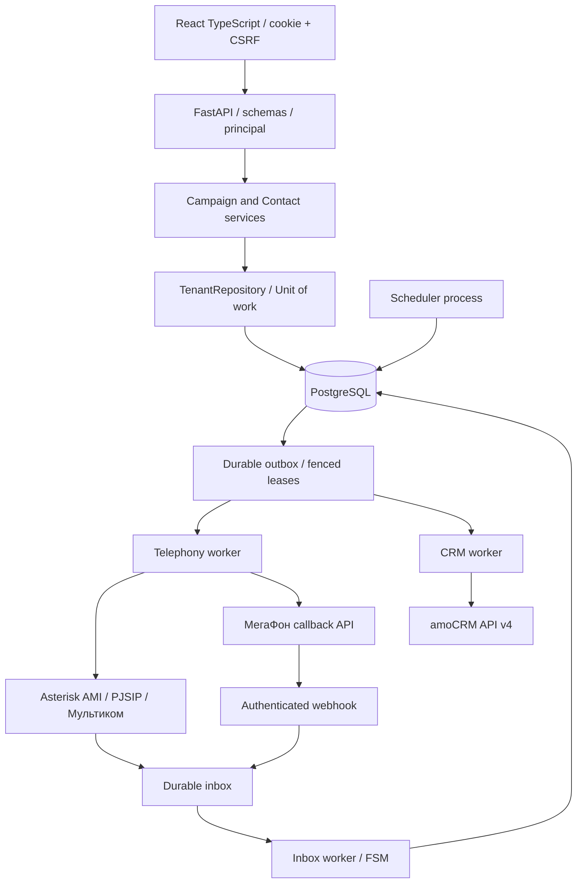

# Целевая архитектура и реализованная бета

## Выбор стека

Модульный монолит **FastAPI + Pydantic 2 + SQLAlchemy 2 + PostgreSQL 17 + Alembic**, React/TypeScript/Vite, независимые worker-процессы. Это сохраняет одну проверяемую кодовую базу и позволяет масштабировать HTTP и интеграции отдельно. Микросервисы на старте увеличат число сетевых отказов и усложнят транзакции без доказанной необходимости.

Для беты очередь — durable PostgreSQL outbox с `FOR UPDATE SKIP LOCKED`, lease и fencing token. **Redis/Celery не обязательны** для нескольких тестовых каналов. PostgreSQL остаётся источником истины. При росте media/LLM задач добавляем Celery/RabbitMQ или Redis с отдельными очередями; публикация идёт из outbox, а не двойной записью «DB затем broker». Broker delivery не заменяет доменную идемпотентность. Redis полезен позже для общего rate limit/realtime cache, не для критических состояний звонков.

Новые зависимости закреплены в `uv.lock` и `frontend/package-lock.json`. Прямые версии frontend закреплены точно. Дата и результаты advisory-проверок — `VALIDATION_RU.md`; отсутствие известных advisory не является гарантией безопасности.

## Слои

* `api.py` — HTTP и DTO. `principal` берётся из DB-backed session, tenant из body/header для обычных операций не принимается. Админские записи проверяются сервером.
* `services.py` — правила кампании, согласий, channel budget, daily cap, переходов. Создание campaign/items/audit атомарно. Сеть не выполняется внутри транзакции.
* `repositories.py`, `models.py`, `db.py` — SQLAlchemy session и tenant-scoped queries. FK tenant+id предотвращают связи объектов разных клиентов.
* `workers.py` — роли scheduler, telephony, inbox, crm. Один и тот же код может запускаться разными процессами. Scheduler блокирует строку tenant при выделении слотов; другие tenants продолжают работу.
* `adapters.py` — AMI framing/response correlation, Megafon HTTP, amoCRM. Провайдерные объекты не зависят от engine/DB. Ошибки: Rejected / Retryable / DeliveryUnknown.
* `domain.py` — независимая монотонная машина состояния. `completed/failed` не возвращаются в ringing/answered при позднем событии.

В дальнейшем routes/services/adapters разделяются по feature-пакетам, когда появится несколько полноценных сценариев. Для текущего небольшого ядра разносить каждый метод на отдельный файл не требуется.

## Схема данных

Реальная версия — `migrations/versions/0001_initial_tenant_schema.py`. В ней 12 таблиц:

| Таблица | Назначение / ключи |
|---|---|
| tenants | timezone, max_channels, daily_limit; tenant row служит коротким allocation mutex |
| users | `(tenant_id, login)` unique; роли admin/operator/viewer, Argon2id, active |
| sessions | hash токена, csrf hash, срок, composite FK к пользователю; исходный токен только в cookie |
| login_buckets | общий persistent limiter, hash ключа, count/reset_at; независим от числа API процессов |
| contacts | `(tenant_id, phone)` unique, E.164, consent/source, block, внешний CRM ID |
| campaigns | `(tenant_id, idempotency_key)` unique + hash request; route, окно часов, лимит, статус |
| campaign_items | composite FK к campaign/contact; unique campaign/contact |
| call_attempts | UUID, маршрут, внешняя корреляция, status/reason, UTC timestamps; в бете одна попытка на item |
| inbox | unique tenant/route/event_key; normalized payload, orphan retry до 5 минут, затем unmatched |
| outbox | unique tenant/dedupe_key; lease UUID, lease_until, attempts, available_at, status/error |
| audit_log | tenant, actor/entity UUID, action/time; без паролей и полного webhook body |
| legacy_map | tenant/source/entity/old ID → UUID; повторяемый импорт без зависимости от имени SQLite-файла |

Индексы: tenant_id у owned-таблиц, items tenant/campaign/status; attempts tenant/status/created_at; outbox kind/status/available_at; inbox status/received_at; audit tenant/created_at; session expiration. Дальше — измерять EXPLAIN ANALYZE на реальном размере данных и добавлять partial indexes по pending/active, BRIN/партиции для истории, без преждевременного партиционирования маленьких таблиц.

Расширение production-схемы: `provider_accounts` (секрет-ссылки, возможности и лимиты), `trunks`, `caller_ids` с разрешёнными CLI, `campaign_runs` с IANA timezone и календарём, `attempt_events` append-only, `recordings` с tenant-aware object keys, `consents` с версией и источником, `do_not_call`, `crm_bindings` и OAuth state, `plans/subscriptions/usage_ledger`. FK всегда включают tenant. DB ограничивает допустимые состояния; контакт не удаляется каскадом вместе с историей звонков.

### Tenant isolation и RLS

В бете есть query scoping, составные FK и негативные тесты, **RLS ещё не включена**. До общего публичного SaaS добавить FORCE ROW LEVEL SECURITY для всех owned-таблиц и отдельные non-superuser/NOBYPASSRLS роли приложения/мигратора. В каждой транзакции задавать `SET LOCAL app.tenant_id` из проверенного principal. Нельзя полагаться на переменную соединения между запросами пула. Worker выбирает задания через ограниченный dispatcher и затем открывает tenant-транзакцию. Тесты должны запускаться под реальной runtime-ролью, а не postgres-superuser.

В бете секреты телефонии и amoCRM привязаны к **одному явно указанному tenant** в конкретном deployment. Это сознательное ограничение, не готовый multi-account secret vault. Нельзя привязать один набор секретов к любому tenant из запроса.

## Воркеры и гарантии

1. API создаёт campaign/items/audit одним commit. Повтор с тем же Idempotency-Key и тем же содержимым возвращает ту же кампанию; другое содержимое — 409.
2. Scheduler под tenant row lock проверяет лимиты/окно/согласие и атомарно создаёт Attempt+Outbox. Повторные scheduler-процессы не создают вторую попытку item.
3. Telephony worker получает lease, проверяет pause/consent/route/allowlist, сохраняет dispatching и только затем делает сеть. Пауза имеет границу до dispatch commit; уже переданный/начатый звонок она не отменяет.
4. Ответ провайдера сохраняет external_id. Timeout после отправки — **unknown**, а не retry dial. Падение после dispatch commit даёт то же безопасное состояние при восстановлении lease. Unknown удерживает channel budget до сверки.
5. Webhook подтверждается только после inbox commit. Inbox transition + terminal call + CRM outbox commit атомарны. Поздний duplicate не создаёт вторую CRM-задачу.
6. CRM retry с jitter/backoff на подтверждённо повторяемых сбоях: connect до отправки, GET failure, 429. 401/403 и некорректный mapping — dead. Write timeout/5xx после POST — unknown, ручная сверка. Marker `ATS#UUID` помогает найти уже созданную note, но не создаёт remote exactly-once гарантию.
7. После 45 минут без terminal event accepted/answered переводится в unknown. AMI не имеет durable replay; до production нужен reconciliation с CDR/CEL/каналами.

Beta fairness: tenants обходятся по одному allocation за тик; внутри tenant кампании идут по created_at. Это не weighted fair scheduler; большой tenant не должен влиять на другие, но очередность нескольких кампаний одного tenant нужно расширить при появлении такой потребности.

## Модель телефонии

**Мультиком SIP → Asterisk/PJSIP → AMI**: ATS не реализует SIP/RTP и не подключает SIP пароли в React. Приложение посылает AMI Originate в ограниченный Local-контекст. UUID попытки передаётся через inherited channel variable. Dialplan посылает UserEvent с этим UUID. Готовится отдельный beta endpoint/trunk и только тестовые направления. SIP signaling, codecs, NAT/RTP, регистрация и разрешённый Caller ID подтверждаются на стороне Asterisk/оператора.

**МегаФон ВАТС callback API**: сначала вызов сотруднику, затем клиенту. Это не поток RTP для AI. Событие ACCEPTED может относиться к первому плечу: новое ядро не обозначает его как ответ клиента. Итог берётся из history; COMPLETED event само по себе не доказывает успешный разговор. Подтверждение реального контрактa конкретного кабинета и тарифа — обязательный gate.

**AI/ASR/TTS** в реализованную beta не включены. Production voice agent — отдельный media worker (ARI ExternalMedia/AudioSocket или согласованный media gateway), поток ASR → сценарий/LLM → TTS, возможность barge-in, cancellation при hangup, лимиты задержки/стоимости, проверяемый аудио-результат. Нельзя включить чат-клиент и объявить голосового бота готовым.

## Аутентификация и scope-билеты

Бета: случайные opaque session tokens, SHA-256 в DB, Argon2id пароли; cookie HttpOnly/Secure/SameSite=Strict, срок 8 часов; роль и active читаются из БД на каждом запросе; logout удаляет session до 204. DB failure → 503, обхода через память нет. Все изменяющие browser API требуют точный Origin и CSRF header. CORS не открыт.

JWT не обязателен для browser UI и усложняет немедленный отзыв. Для будущих machine clients/OIDC: короткий JWT с проверенными iss/aud/exp/jti и membership, refresh rotation/reuse detection, revoked session version. Tenant из JWT проверяется по membership, не доверяется отдельному заголовку.

SSE/recording/export пока не опубликованы в новом API, поэтому URL-ticket endpoint отсутствует. Когда появятся — отдельная таблица с hash, tenant/user/session, purpose, resource UUID, exp≤60s; атомарный consume только при полном совпадении, повторная проверка membership/active, один use. Не принимать билет в универсальном auth dependency. Старую безопасную семантику scoped tickets нужно сохранить; широкая query-token авторизация запрещена. Для CRM записей — отдельные короткие tenant/resource-bound подписанные ссылки, не browser session.

## Чего эта версия пока не обещает

Нет billing/self-service, inbound-операторского рабочего места, ACD-переводов, записей/S3, caller-ID rotation, автоматических call retries, голосового AI, универсального OAuth onboarding клиентов и RLS. Импортёр переносит контакты, не все исторические таблицы. Это исполняемый минимальный кандидат для закрытой беты исходящего дозвона и CRM notes, а не полная feature-parity копия legacy и не production-ready SaaS.
