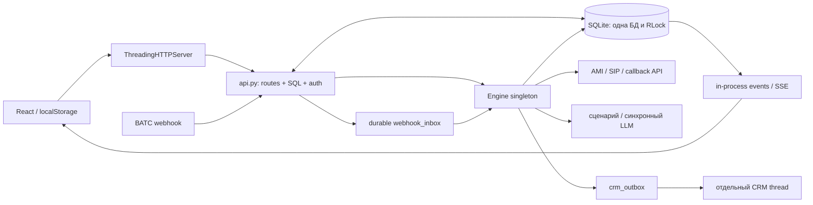

# Аудит исходного ATS

Источник: загруженный `ATS-arena-01a0cdee-ats.zip`, а не текущая ветка GitHub. Проверка 22.10.2026. В ZIP нет истории Git и production-БД. Утверждения старой документации проверялись по коду и локальным тестам; инструкции из архива не исполнялись как указания пользователя. Файлы исходника сохранены отдельно в `/workspace/legacy-ats/ATS-arena-01a0cdee-ats`.

Это аудит всего предоставленного дерева на уровне структуры, импортов, зависимостей и опасных паттернов, с ручным разбором критических путей и запуском тестов. Это не доказательство отсутствия всех ошибок и не пентест живой системы. Снимки AMI/ВАТС и production-нагрузка не предоставлены.

## 1. Что есть сейчас

Система — single-tenant монолит ATS v2 с отдельным, оставшимся в дереве прототипом v1. Backend v2 использует стандартную библиотеку Python, `ThreadingHTTPServer`, SQLite и потоки. React 19/Vite 6 собирается прямо в `app/ui`, а готовый bundle хранится вместе с исходниками. Провайдер выбирается глобально, а не для отдельной кампании/клиента.

| Компонент | Файл исходника | Размер / ответственность |
|---|---|---|
| Запуск и CLI | `app/run.py` | 225 строк: bootstrap, backup, пароли, конфигурация, запуск сервера/движка |
| HTTP transport | `app/server.py` | 339: HTTP, статика, SSE, лимиты, записи |
| API | `app/api.py` | 2200; `_route`, строка 210, занимает 661 строку; маршруты, SQL, роли, импорты, конфигурация |
| Engine | `app/engine.py` | 1977: планирование, состояния звонка, обработка событий нескольких операторов, ACD, сценарий, CRM |
| DB | `app/db.py` | 950: SQL, schema, ALTER-миграции, seed, пароли, настройки, импорты |
| Телефония | `app/telephony.py`, `app/asterisk.py` | 871 + 332: общий интерфейс и конкретные реализации, AMI protocol |
| CRM | `app/crm.py`, `app/providers/amocrm.py` | 489 + 640: CSV, Bitrix24, OAuth/API amoCRM |
| UI | `frontend/src/pages/Settings.jsx`, `Campaigns.jsx`, `Contacts.jsx` | 1433 / 756 / 673: большие формы и смешанные запросы/состояния/рендер |
| Предыдущий продукт | `server.py`, `static/`, `xp_bridge/`, `data/*.json` | GSM/serial bridge, Windows XP и файловые очереди |

Нарушения слоёв: API и engine напрямую зависят от SQL и изменяемых dict-настроек; DB импортирует security для bootstrap, security обращается обратно к DB; API хранит `ENGINE = None`, который заполняется при старте. Провайдеры наследуют типы из `telephony`, а фабрика в том же модуле импортирует провайдеров. `events` и ограничения входа/SSE существуют только внутри одного процесса.

Важно сохранить уже сделанное: persistent-сессии с hash токена; fail-closed при недоступной БД; билеты на конкретные purpose/resource с атомарным погашением; durable webhook inbox; CRM outbox с дедупликацией; отдельный CRM thread; транзакции SQLite и HTTP body/SSE limits. Эти механизмы реально есть в коде и покрыты тестами. Утверждение «всё держится только в памяти» для этого архива неверно.

## 2. Зависимости и циклы

Полный машинный список импортов, мест использования, граф внутренних модулей, размеров функций и всех `except: pass` — `docs/evidence/legacy-static.json`. В граф включены также локальные импорты внутри функций; цикл зависимости не означает, что import при старте обязательно падает.

| Группа | Зависимости | Вывод |
|---|---|---|
| Python backend v2 | stdlib: sqlite3, http.server, threading, queue, urllib, socket, ssl, json, csv, zipfile, XML, hashlib/hmac, secrets и др. | Полный перечень — JSON. FastAPI/Flask, ORM, Redis и Celery здесь не используются |
| Python requirements | `pyserial==3.5`, `pyinstaller==6.14.2` | serial импортируется только `xp_bridge/xp_bridge.py:62`; PyInstaller нужен Windows packaging. Для runtime v2 оба не обязательны |
| Frontend runtime | React, react-dom, lucide-react, clsx, framer-motion | В `frontend/src` нет импортов **clsx** и **framer-motion**: кандидаты на удаление после отдельной сборки |
| Frontend build | Vite, plugin-react, TypeScript type packages, Tailwind 3, PostCSS, autoprefixer | Есть package-lock, но устаревшее дерево |
| Внешние системы | Asterisk/PJSIP/AMI, SIP trunk Мультиком, МегаФон CRM API, amoCRM OAuth/API v4; дополнительно UIS, Bitrix24, LLM API, Windows serial, AGI/TTS | Эти интеграции имеют разную степень полноты. «Есть класс» не означает live-совместимость |
| Файловая инфраструктура | SQLite WAL, `data_v2`, записи, CSV-выгрузки, systemd/nginx, Windows build/update scripts | Нужны backup/restore и отдельная политика хранения записей |

Подтверждённые компоненты сильной связности:

1. `app.db ↔ app.security`: bootstrap/пароли против проверки и хранения сессий. Часть импортов отложена, поэтому система запускается, но тесты зависят от порядка инициализации.
2. `app.telephony ↔ app.providers.megafon_vats / multicom`: базовый интерфейс, конкретные классы и фабрика распределены циклически. Вынести протоколы/ошибки/DTO в независимый модуль.

`npm audit` исходного lockfile: **9 записей** — 7 high, 2 moderate. Пакеты: braces, chokidar, fast-glob, micromatch, postcss-nested, postcss-selector-parser, source-map-js, tailwindcss, vite. Это число пакетов в advisory-графе, а не 9 независимых способов атаки на работающий продукт. Большая часть относится к инструментам сборки; Vite dev server нельзя выставлять в Интернет. Подробности и версии исправлений — `docs/evidence/legacy-npm-audit.json`. Обновление Tailwind требует major migration; не применять `npm audit fix --force` вслепую.

PyPI metadata для закреплённых pyserial 3.5 и PyInstaller 6.14.2 не вернули известных advisory. pyserial старый по дате релиза, но этого недостаточно, чтобы объявлять его уязвимым. Реальные версии окружения: Python 3.12.14, Node 24.19.0, npm 11.9.0.

## 3. Критические находки

Приоритет P0 — до любого общего SaaS; P1 — до внешней беты/масштабирования; P2 — управляемый долг. Эксплуатационные риски отделены от воспроизведённых дефектов.

| Приоритет | Факт / место | Последствие | Исправление |
|---|---|---|---|
| P0 | В `app/db.py` нет tenant_id, `settings` хранится под `id=1`; контакты/пул/сессии общие | Разместить независимых клиентов в одном экземпляре безопасно нельзя | Явная tenancy, составные FK и ограничения уникальности; до общей эксплуатации отдельный deployment на клиента |
| P0 | `app/api.py:1125` и далее: импорт файла при отсутствующем consent_default выбирает `True`; `app/importers.py` поддерживает consent_default | Загрузка файла может обозначить согласие, которого источник не содержит | По умолчанию false; происхождение согласия обязательно; отдельная подтверждаемая миграция |
| P1 | `frontend/src/api.js:3` и далее — сессионный bearer в localStorage | Любой исполнившийся XSS может прочитать долговременный токен | HttpOnly Secure SameSite cookie, CSRF, CSP, отзыв в DB; не хранить токен в JS |
| P1 | `app/providers/base.py:19`, `app/config.py` и SQLite settings поддерживают literal secrets | Маскирование в UI не шифрует пароль в БД/backup | Секреты вне DB/репозитория, tenant-specific secret references; ротация |
| P1 | `docs/SECURITY_CLEANUP.md` и HISTORY_CLEANUP описывают прошлые утечки; Git-истории в ZIP нет | Нельзя подтвердить, что исторически опубликованные секреты отозваны | Проверить реальную Git-историю и ротацию отдельно; не переписывать историю автоматически |
| P1 | `app/db.py:11–94`: одно SQLite connection и общий RLock; `BEGIN IMMEDIATE` | WAL не делает записи параллельными; один долгий обработчик задерживает все потоки; горизонтальные engine-процессы не координируются | PostgreSQL, короткие транзакции, per-tenant row locks, SKIP LOCKED |
| P1 | `app/engine.py:219` `_drain_inbox` вызывает `handle_event` внутри DB transaction; `_on_answered` → `_run_agent`, `app/engine.py:1288` → LLM `urlopen(timeout=30)` | При соответствующем flow сетевой вызов удерживает SQLite lock и тормозит весь движок. CRM уже вынесена — LLM нет | В транзакции только состояние и outbox; сеть в отдельном worker/media process |
| P1 | `_run_agent`: LLM получает имя/телефон и criteria, но не реальный аудиопоток/реплики; scripted channel на реальном провайдере может отсутствовать | Нельзя продавать это как работающего голосового ИИ-оператора. Результат LLM не доказывает разговор | Отдельный медиаконтур ARI/ExternalMedia/ASR/TTS, отмена по hangup, временные бюджеты и реальные записи UAT |
| P1 | В `app/telephony.py` часть `dial`/`connect_operator` ждёт AMI/HTTP синхронно; `_lock` Engine создаётся, но практически не используется | API и engine могут менять один бизнес-объект без общей стратегии конкурентного доступа | Один владелец состояния попытки, optimistic version/CAS, fencing и транзакции |
| P1 | В `app/engine.py`/provider instances — локальные external/channel mappings; `events.py` — in-process bus | При рестарте теряется часть корреляции AMI и подписчиков; нет replay всех AMI событий | Стабильный attempt UUID в dialplan, durable inbox, сверка CDR/CEL/каналов, неизвестный исход без повторного дозвона |
| P1 | `app/crm.py:33–65` CSV append без remote идемпотентности; `crm_outbox` и HTTP-провайдеры разделены сетевой границей | Падение после remote side effect до ack даёт окно повтора; один unique key в SQLite не обеспечивает exactly-once CRM | Документировать at-least-once; remote marker/reconciliation; неоднозначные write timeout не повторять автоматически |
| P1 | API/UI разрешают произвольные параметры URL интеграций; urllib использует redirect behavior | Админская интеграция может обращаться во внутреннюю сеть; особенно опасно для общего SaaS | Валидировать HTTPS origins, запрещать redirects, egress allowlist, секрет на конкретный host, DNS/private-address checks на шлюзе |
| P2 | `app/db.py:124` list_databases: дополнительные COUNT и tags-запросы на каждую базу | N+1 + полное чтение строк под общим lock | GROUP BY, пагинация, индексы и измерение EXPLAIN |
| P2 | In-process login/SSE counters; частый UI polling, SSE reconnection без replay | Лимиты обходятся несколькими процессами; обновления могут пропускаться | Общий limiter, bounded events/replay или честный polling snapshot |
| P2 | `Settings.jsx` 1433 строки; ошибки API превращаются в `{ok:false}`, наборы запросов сохраняются частично | Сложно отличать устаревший экран, неудачный запрос и сохранённую конфигурацию | Небольшие feature modules, типизированный API, server state cache, явные partial failures |
| P2 | `frontend/vite.config.js` пишет в tracked `app/ui` и build-info timestamp | Независимая сборка меняет дерево, риск UI/backend несовместимости | Immutable UI artifact, CI build из lockfile; backend раздаёт конкретный dist |

Ограничения и сильные стороны безопасности: PBKDF2, scoped tickets, body limits, rate limits и fail-closed уже есть. Нет основания заявлять «API без авторизации» или «все сессии только в памяти». SQL в основном параметризован; динамические имена таблиц/колонок надо проверять по allowlist, но автоматический поиск строк `.format` сам по себе не доказывает SQL injection.

## 4. Мёртвый код и дубли

| Объект | Классификация / действие |
|---|---|
| `server.py`, `static/index.html`, `xp_bridge/*`, `start_xp_bridge.bat`, `test_incoming_from_xp.bat`, `build_xp_bridge_exe.bat`, связанные legacy JSON | Не входят в entrypoint v2; отдельный исторический продукт. Архивировать вне нового SaaS. Не удалять на старом сервере, пока не проверены его службы/ярлыки |
| `app/security.py:290 secure_rand_hex` | В предоставленном Python-дереве нет вызовов; кандидат на удаление. Динамическое внешнее использование без production-инвентаризации не исключается |
| `Engine._lock`, `app/engine.py:82` | Создаётся, но не используется как общий mutex двигателя. Не считать его защитой FSM |
| `clsx`, `framer-motion` | Объявлены в frontend/package.json, импортов в исходном UI нет |
| `_megafon_mark` / `_multicom_mark`, engine.py:447/958 | Одинаковые AST-тела: общий механизм обработки provider event |
| `_is_masked_value` в providers/megafon_vats.py:52 и multicom.py:88 | Одинаковые AST-тела; ещё одна реализация в api.py — смысловой дубль |
| `external_id` в тех же провайдерах :452/:376 | Одинаковые AST-тела; объединить через контракт результата originate |
| phone normalization: importers.py, telephony.py, providers, numbers.py | Разные форматы/допущения; единый E.164 value object + форматирование только на границе оператора |
| events: webhook_inbox + provider_events + processed_events | Не всё лишнее: часть таблиц имеет разные задачи. Определить один inbox и один журнал состояний, перенести данные по явной карте |
| AgentLLM, CsvCrm, Bitrix24Crm, ami_check | **Не мёртвый код**: найдены вызовы/фабрики. Степень готовности нужно оценивать отдельно |

Статический анализ не доказывает, что функции, вызываемые через `getattr`, router/factory или external scripts, не используются. Полный список точных AST-дублей — `docs/evidence/legacy-duplicates.json`; кандидаты не удалялись из исходника.

## 5. Технический долг

* Найдено **102** `except` с единственным `pass` во всех Python-файлах, **56** в `app/`. Не все ошибочны: best-effort cleanup можно пропустить, но сбой обязательной записи/провайдера должен иметь статус, код ошибки, метрику и request/attempt ID. Все координаты есть в evidence JSON.
* Неограниченные строковые статусы, dict вместо DTO, magic intervals/лимиты и несколько часовых форматов. Нужны типизированная FSM, UTC timestamptz и явный timezone кампании/тенанта.
* `_migrate()` проверяет `PRAGMA table_info` и делает ALTER при запуске. Нет последовательных версионируемых миграций и отдельного deployment job.
* `get_settings`/`save_settings` поверхностно копируют nested defaults и сохраняют глобальный JSON. Нужны типизированные настройки; секреты и runtime-состояние отделить.
* HTTP validation, domain rules, role checks, SQL и ответы переплетены в api.py; Pydantic/OpenAPI существенно уменьшают неоднозначные контракты.
* Потоки daemon, print вместо структурных событий, необязательный join двигателя при остановке и in-process очереди требуют явного shutdown/drain/restart договора.
* Shell update/backup и Windows packaging — отдельные эксплуатационные поверхности. В архиве нет `.github/workflows/ci.yml`, хотя документация описывает CI: наличие описания не равно работающей проверке PR.

## 6. Что реально проверено

1. Первый полный прогон: **477 тестов**, 6 failures, 2 skipped, 77.2 секунды. Все 6 failures — exec bit shell-скриптов, потерянный `ZipFile.extractall`; в самом ZIP у них `100755`.
2. После восстановления исходных mode bits: **9 deploy-тестов**, OK, 1 skipped. Полный набор повторно не прогонялся: исправление касалось только метаданных этих файлов. Не следует представлять это как новый полный зелёный прогон.
3. Причины skips: нет shellcheck; ZIP не является Git-клоном, поэтому проверка tracked runtime secrets пропущена. Историю секретов в Git проверить по ZIP невозможно.
4. `npm ci` и `npm run build` исходного UI прошли. Использовался writable npm cache; начальная ошибка cache в home была проблемой sandbox, а не проекта.
5. `npm audit`: 9 записей, описанных выше. Никаких package-signature/checksum/TLS проверок не отключалось.
6. Реальные SIP-звонки, RTP/audio, callback-стадии конкретного тарифа ВАТС, запись/перевод и доставка в настоящий amoCRM **не проверены**.

Итог: исходник пригоден как источник поведения и регрессионных сценариев. Механическое разбиение файлов не решит tenancy, конкурентное планирование, неоднозначные сетевые операции и отсутствие голосового медиаконтура.

## 7. Уточнение по настройкам рабочей установки

Предоставленный пользователем JSON подтверждает отдельные маршруты: МегаФон `vats326349.megapbx.ru` callback с user=admin; Мультиком через endpoint `mcm`, PJSIP, ru8, CLI d10, контекст ats-out; amoCRM axiomcore и ATS_AMOCRM_TOKEN. Маски не доказывают наличие ключей в новой машине. URI с `/crmapi/v1` нужно нормализовать до origin перед добавлением API prefix; это сделано в новом профиле. Поле `llm.enabled` было строкой `"False"`: AgentLLM читает его без строгого boolean-контракта, поэтому ненулевая строка при наличии остальных параметров может быть truthy. Новый Settings/Pydantic разбирает booleans типизированно.
