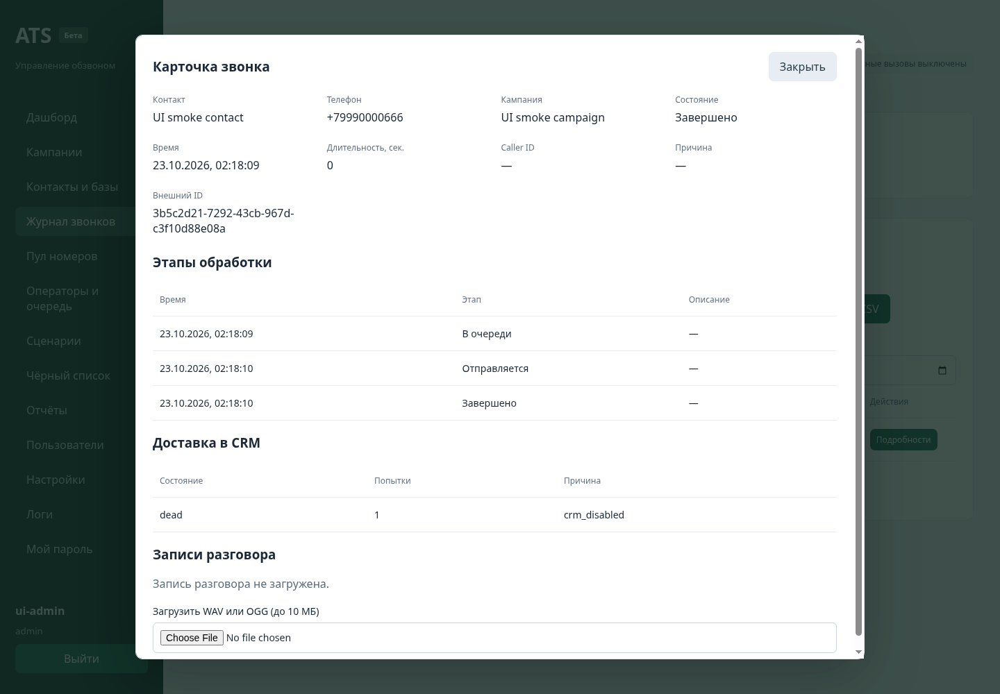
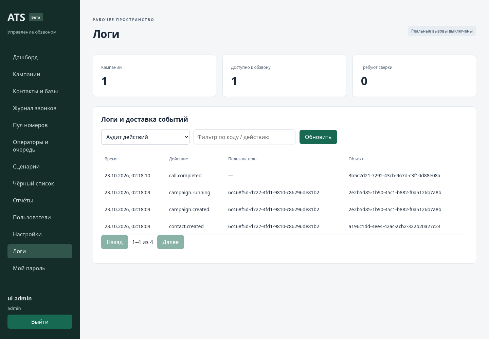

# Восстановление рабочего кабинета · версия 0.2

Источник сравнения: frontend/src/pages и app/api.py архива ATS-arena-01a0cdee-ats. Перенос выполнен в FastAPI/PostgreSQL/TypeScript; старый HTTP-router, SQLite runtime и хранение токена сессии в localStorage не подключаются к новому приложению.

Это расширение закрытой беты. Наличие экрана и контрактного теста не означает проверенную работу телефонии у оператора. На предоставленном сервере симулятор работает, но UDP-регистрация у 95.128.224.47:5060 остаётся без ответа; живые вызовы этой версией не проверены.

| Раздел старой ATS | Реализовано в новом проекте | Проверка |
|---|---|---|
| Dashboard | Общие счётчики PostgreSQL, активные попытки, лимиты пространства | API + Chromium |
| Контакты | Создание, редактирование, группа/email/заметки, поиск, страницы, история, архивирование без потери звонков | API + Chromium |
| Базы | Создание/удаление списков, фильтр по базе, CSV/XLSX/текстовый импорт до 1000 строк, обработка дублей, экспорт CSV | API |
| Согласия | Явный источник; импорт не восстанавливает отзыв; запрет проверяется до отправки провайдеру | API/worker |
| Кампании | Создание, редактирование при отсутствии активных вызовов, старт/пауза, добавление контактов, выбор всей базы/поиска до 1000 контактов, архив | API + Chromium |
| Очередь кампании | Список контактов и результатов, отмена оставшейся очереди, ручной повтор ошибочных попыток с сохранением истории | API/worker |
| Расписание | Часы и дни недели в часовом поясе пространства; повторная проверка перед отправкой | API/worker + UI |
| Повторы | Ограниченный retry/backoff по подтверждённым busy/no_answer/connect_failed; неизвестный исход не повторяется | worker |
| Журнал | Контакт, телефон-снимок, кампания, маршрут, причина, длительность, фильтры, даты, страницы, CSV | API + Chromium |
| Карточка звонка | Этапы обработки, состояние CRM/outbox, результат сценария, записи и ручная сверка unknown | API + Chromium |
| Завершение вызова | Отмена prepared/sim; AMI Hangup через очередь только для известного канала своего пространства | API/transport; live UAT нужен |
| Входящие | AMI-наблюдатель разрешённых контекстов, МегаФон event/history/contact, дедупликация, отдельный журнал и CRM-задача | API/worker; live UAT нужен |
| Пул Caller ID | CRUD, разрешение номера, карантин, суточный лимит, пауза, выбор и резервирование номера под tenant lock, проверка перед отправкой | API/worker; правила CLI подтвердить у оператора |
| Жалобы/чёрный список | Запрет по телефону, отзыв согласия, жалоба, автоматический карантин последнего Caller ID по настраиваемому порогу | API/worker |
| Шаблоны | Текст сообщения, редактор вопросов/ветвлений, квалификация, архивирование и прогон без звонка | API + Chromium |
| Голосовое сообщение/сценарий | Отдельный локальный AGI, espeak-ng/sox без shell, русская озвучка, DTMF-ответы, ограничение цикла, результат через durable inbox | AGI unit tests; звуковой тракт не проверен |
| Операторы | Создание пользователей/профилей, статусы, очередь задач, эксклюзивное принятие/завершение, резервирование до исходящего звонка | API/worker; live UAT нужен |
| Перевод оператору | Dial внутреннего PJSIP endpoint после ответа/квалификации, освобождение оператора по терминальному событию | Dialplan + AMI contract; live UAT нужен |
| Записи | MixMonitor в отдельном каталоге, автоматическое прикрепление, ручная загрузка WAV/OGG до 10 МБ, защищённое прослушивание | API + AGI/filesystem; MixMonitor live UAT нужен |
| Ссылки записей | Отдельная ссылка на одну запись, срок 1–72 часа, хранение только хеша токена, отзыв ссылки | API; внешняя доступность требует HTTPS origin |
| amoCRM | Примечание с маркером, официальный /calls с uniq, поиск/опциональное создание контакта, задачи, binding tenant, leases/backoff и unknown при неопределённом POST | HTTP contracts; live UAT нужен |
| Справочники | Чтение пользователей amoCRM и сотрудников/групп/номеров МегаФон в фоне; ограниченная пагинация | worker/HTTP contracts; live UAT нужен |
| Настройки | Имя, timezone, бюджеты, параметры обработки CRM, ответственный, режим кампании; признаки настроенных секретов, фоновые проверки подключений | API + Chromium |
| Пользователи | Роли admin/operator/viewer, активность, смена пароля, внутренний номер, отзыв сессий, защита последнего администратора | API + UI |
| Отчёты | Итоги состояний и доля завершённых попыток, период и динамика по дням | API + Chromium |
| Административные логи | Аудит действий, события API/воркеров, поиск по request_id, inbox/outbox, причина отказа и ручной повтор безопасно завершившейся задачи | API + Chromium |
| История старой ATS | Read-only импорт контактов/баз/шаблонов/кампаний/номеров/запретов/истории/пользователей/операторов с постоянными legacy mappings | SQLite/PostgreSQL tests |

## Изменения поведения при переносе

* Удаление контактов, кампаний и шаблонов стало архивированием: старые звонки и аудит сохраняются. Очистка очереди отменяет оставшиеся элементы, не удаляет историю.
* История попытки хранит фактический телефон и имя. Редактирование контакта не переписывает телефон уже состоявшегося звонка.
* Входящий контакт не получает согласие на исходящий обзвон автоматически.
* Номер не становится разрешённым Caller ID только из-за импорта или попадания в справочник. Операторское разрешение подтверждает администратор.
* Мёртвые/ошибочные CRM-задачи доступны для ручного повтора. Задачи с неизвестным результатом POST нельзя слепо отправить заново.
* Экспорт идёт с HttpOnly-сессией. Секрет сессии не помещается в URL. CSV защищён от формул Excel.
* Параметры маршрутизации/ключи операторов задаются в защищённом окружении сервера. Произвольный legacy JSON с паролями в БД не переносится.
* Импортированные кампании имеют маршрут sim и состояние paused. Активные/уже обработанные старые элементы не ставятся на автоматический новый дозвон.
* Импортированные новые аккаунты выключены, имеют новый случайный хеш пароля, операторы offline. Существующий администратор беты сохраняется. Перед активацией сотруднику задают новый пароль.

## Границы, которые остаются явными

Полной идентичности всех legacy-кнопок и API ещё нет. В этом выпуске нет удаления тестовой истории без кампаний, сброса суточного счётчика с обходом бюджета, прямого редактирования raw provider JSON из браузера, CRM OAuth marketplace flow/Bitrix24/UIS, S3 и голосового ASR/LLM-диалога. Часть этих пунктов была незавершёнными каркасами в исходнике; часть требует отдельного переноса. Нельзя называть выпуск стопроцентной заменой legacy или публичным production SaaS.

Live UAT должен проверить: SIP-регистрацию, разрешённый CLI, RTP в обе стороны, озвучку/DTMF, перевод на реальный внутренний endpoint, окончания вызовов, запись и реальную карточку amoCRM. До этого ATS_LIVE_CALLS_ENABLED/ATS_INBOUND_ENABLED/ATS_MEDIA_ENABLED остаются выключенными на действующем сервере. Старые webhook/context нельзя переключать на бету без маршрутизации по владельцу вызова.

Доставка событий в интерфейс сейчас выполняется polling раз в 5 секунд; старый SSE не используется. Общие числа берутся из агрегатов БД, а не из первых 100 записей.

## Проверка интерфейса

Снимки ниже получены из Chromium на синтетическом simulator-пространстве. Это реальные экраны новой сборки, не макеты.

