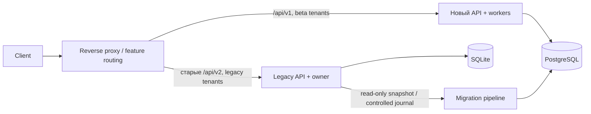

# Миграция SQLite → PostgreSQL и Strangler Fig

Старую SQLite и активные каналы не переключаем одновременно. Главный инвариант — ровно один владелец планирования каждого campaign/item; два API рядом не должны означать два автодозвона по одной очереди.

## 1. Инвентаризация и snapshot

1. Найти фактические ATS_DATA_DIR/ATS_DB, PID/службы, выбранный provider, версии Asterisk/PJSIP, активные кампании/вызовы и CRM outbox. Пароли и токены не включать в отчёт.
2. Сделать согласованный snapshot через `sqlite3.Connection.backup()`; простое копирование `.db` при WAL может потерять записи. Запустить integrity_check, сохранить SHA256 snapshot и сделать пробное восстановление в отдельный каталог.
3. Отдельно сохранить записи/экспорты, права, метаданные путей и историю версий. Секреты мигрируют через vault/settings, а не через общий JSON dump. Старые browser sessions не импортировать — повторный вход.
4. Создать destination tenant и source-id, который стабилен при следующих snapshots одного инстанса. Никогда не вычислять source-id из хеша изменяющейся DB или basename файла.

## 2. Карта данных

| Legacy | Новая модель / правило |
|---|---|
| users, sessions, auth_tickets | users/memberships с tenant; админ задаёт новые пароли либо отдельный ограниченный legacy password verifier на переходный период. Сессии и билеты не переносятся |
| contacts/databases/tags | contacts + future contact_lists/list_memberships; UUID через legacy_map; нормализация E.164, collisions в карантин; согласие без источника не восстанавливать как true |
| blacklist/complaints | блокировка контакта + будущая do_not_call history; запрет должен победить любой положительный импорт |
| campaigns/campaign_items/templates | campaign/runs/items/scenario versions; все импортированные кампании paused; старое running нельзя автоматически активировать |
| calls/attempts/acd/agent_sessions | append-only historical calls/events, сохранение исходного статуса отдельно от новой FSM; активные звонки обслуживает старый engine до terminal/drain |
| numbers/vats_users/vats_groups/settings | provider_accounts, caller_ids, staff mappings; настройки разделить, неизвестный CLI не давать на исходящий. Не импортировать literal secrets |
| webhook_inbox/provider_events/processed_events | сохранить migration epoch + original provider/event IDs; не replay обработанные события заново |
| crm_outbox | сначала остановить старый CRM writer и выгрузить acknowledged/inflight/unknown; перенести только подтверждённо pending с тем же external marker. Не отправлять done заново |
| recordings | tenant/call object key, checksum/size/retention; пути к файлам из DB не использовать как произвольные filesystem paths |

**Реализованный `python -m ats.cli import-contacts` переносит только контакты**, с dry-run по умолчанию, quarantine IDs, conservative merge, legacy_map и повторяемостью. Исторические звонки, списки, сценарии, provider settings и полная delta-migration пока описаны планом, а не выданы за готовые команды.

```bash
source scripts/dev-env.sh
.venv/bin/python -m ats.cli import-contacts \
  --sqlite /secure/snapshots/ats.db --tenant-id TENANT_UUID --source-id customer-a
# Проверить отчёт; затем та же команда с --apply.
```

Dry-run открывает read-only snapshot и проверяет структуру/валидность. Повторный импорт того же source/ID пропускает уже перенесённую строку; это **не CDC и не обновление изменённых контактов**. Для cutover потребуются change journal с source version/LSN, revision-aware upsert и tombstones. Одного timestamps polling недостаточно для deletes и одинаковых секунд обновления.

## 3. Параллельный API



Сначала новый API обслуживает health и shadow-read из импортированного snapshot. Сравнивать нормализованные ответы и статусы; **shadow-write в телефонию запрещён**. Затем новый tenant/кампания создаются только новым API. Identity gateways проверяют старые/новые cookie отдельно; не переносить токен через URL и не доверять присланному tenant_id.

Переход существующей кампании: остановить новые назначения в старом engine, оставить текущие разговоры; дождаться terminal либо сверить каждый активный UUID с CDR/CEL; зафиксировать dispatch watermark и мигрировать оставшиеся items. Отключить старого scheduler-владельца этой кампании, затем включить нового. Вебхуки маршрутизировать по provider-account и owner epoch; нельзя отправлять одно событие двум движкам, которые оба делают CRM side effect.

## 4. Что означает «без простоя»

HTTP/read UI и активные звонки можно сохранить доступными весь переход. При текущем legacy без надёжного CDC **нулевую паузу новых назначений гарантировать нельзя**. Практичный вариант — короткая контролируемая пауза назначения на tenant/campaign для final delta и fencing. Текущие Asterisk-разговоры продолжаются.

Если бизнес требует непрерывных новых назначений, сначала нужен установленный journal/owner protocol в legacy, catch-up lag и атомарная смена epoch. Это отдельное изменение старого проекта, которого в этой выдаче нет. Два независимых scheduler с copied DB не являются zero-downtime миграцией.

## 5. Rollback

* До смены writer — вернуть proxy route на старый API, новый DB не разрушать.
* После смены writer — pause нового назначения, drain текущих попыток, сохранить его журнал и список всех отправленных UUID/provider IDs; сначала сверка, затем reverse delta и передача owner обратно.
* Нельзя восстановить старую SQLite snapshot и запустить её очередь: уже набранные после snapshot телефоны могут получить повторный вызов.
* DB migrations: expand/contract; rollback бинарника только на совместимую схему. `alembic downgrade` разрушительной initial migration не является production rollback.

## 6. Приёмка

Полная сверка количества строк и ID map по tenant, FK anti-joins, collisions phones, выборочные hashes полей, согласия/blacklist, timestamps/UTC, внешние IDs, записи/checksums, CRM done/pending/unknown. Dry-run и apply повторяются в staging; второй apply не должен создавать новые строки.

Нагрузочные тесты: реальные JSON API, пагинация на production-like data, 100/500 concurrent browser sessions по согласованному SLO; scheduler workers параллельно, медленная CRM не влияет на dispatch; повтор/перестановка вебхуков, outage DB/AMI/CRM, процесс kill после remote side effect. Измерять error rate и latency по всем ответам, lag/старейший outbox, активные/unknown attempts. Текущий HTTP-smoke — только локальная функциональная проверка, не доказанная ёмкость SaaS.

Live Asterisk gate: ограниченные тестовые номера, busy/no-answer/answer/remote hangup, SIP 4xx/5xx, NAT/RTP, AMI disconnect/reconnect, CDR сравнение, правильный CLI, отсутствие дубля originate после timeout/restart. МегаФон: отдельно operator/client legs, history/webhook order и retries. amoCRM: правильный tenant/contact ID, один внешний marker, 429 backoff, 401 и ambiguous-write сверка. Протокол — `BETA_RUNBOOK_RU.md`.
